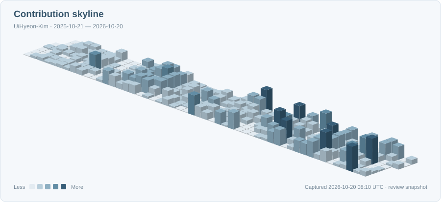

  

<h1 align="center">김의현 · Android Developer</h1>

  앱에서 만난 문제를, 다음 앱에서도 쓸 수 있는 코드로 정리합니다 
  <b>Kotlin · Jetpack Compose</b> &nbsp; / &nbsp; SSAFY 16기

  

  

<h2>Selected Projects</h2>

<table width="100%">
  <colgroup><col width="50%"><col width="50%"></colgroup>
  <tr>
    <td width="50%" valign="top">
      <h3><a href="https://github.com/Central-MakeUs/Rodi-Android">🚗 Rodi</a></h3>
      
<b>초보 운전자를 위한 운전 코스 추천 앱</b>입니다. 수준에 맞는 연습 장소와 코스를 찾고, 경로 안내와 실제 운전 연습으로 이어지도록 돕습니다.

      
<b>담당 구현·개선</b>

      <ul>
        <li>위치 대기·미확보 상태를 분리해 홈 영구 로딩 개선</li>
        <li>코스 경로 기반 진행률·도착 판정과 방문 확인 흐름 연결</li>
        <li>상태·경계 조건 테스트와 CI·빌드 검증 흐름 정비</li>
      </ul>
      
<a href="https://github.com/Central-MakeUs/Rodi-Android/pull/87">위치 미확보 처리</a> · <a href="https://github.com/Central-MakeUs/Rodi-Android/pull/108">진행률·도착 판정</a>

    </td>
    <td width="50%" valign="top">
      <h3>💪 PoseUp</h3>
      
스마트폰으로 푸쉬업을 연습하는 사용자를 위한 운동 코칭 앱입니다. 카메라로 자세를 분석하고, 횟수·세트·휴식과 운동 기록을 안내합니다.

      
<b>담당 구현·개선</b>

      <ul>
        <li>빠른 동작에서 발생하는 카운트 누락 판정 보정</li>
        <li>세트 목표·준비·휴식 상태에 맞춘 화면과 음성 안내</li>
        <li>카메라 종료·화면 이탈 시 늦은 음성 요청과 콜백 무효화</li>
      </ul>
      
<a href="https://uihyeon-kim.github.io/UiHyeon-Kim/#/project/poseup">PoseUp 프로젝트 소개</a> · 소스 비공개

    </td>
  </tr>
  <tr>
    <td width="50%" valign="top">
      <h3><a href="https://github.com/UiHyeon-Kim/Pickle-Android">🥒 Pickle</a></h3>
      
소비 기록을 공유하며 의견을 나누고 싶은 사용자를 위한 가계부 앱입니다. 월별 소비 내역·통계를 확인하고, 친구에게 소비 심판을 요청할 수 있습니다.

      
<b>담당 구현</b>

      <ul>
        <li>Clean Architecture·멀티모듈 기반 초기 구조 설계</li>
        <li>Google·Kakao 로그인, 공통 토큰 갱신과 암호화 저장</li>
        <li>소비 심판·초대 화면과 배심원 정보 응답 매핑 구현</li>
      </ul>
      
<a href="https://github.com/UiHyeon-Kim/Pickle-Android#engineering-highlights">인증 처리 구현</a> · <a href="https://github.com/UiHyeon-Kim/Pickle-Android/commit/c5e943e34c5c3f34853b8887ff1ebc21a636158d">배심원 응답 매핑</a>

    </td>
    <td width="50%" valign="top">
      <h3><a href="https://github.com/LIKELION-Android-Bootcamp-4th/FinalProject-GureumPage-HIHIHIHI">☁️ 구름한장</a></h3>
      
읽은 책과 떠오른 생각을 함께 정리하려는 독자를 위한 독서 기록 앱입니다. 독서 기록·마인드맵·통계로 읽은 내용과 독서 습관을 돌아볼 수 있습니다.

      
<b>담당 구현</b>

      <ul>
        <li>공통 테마·디자인 시스템과 온보딩 화면 구축</li>
        <li>마인드맵 편집·저장 시 최종 상태 비교로 변경 연산 계산</li>
        <li>독서 통계 화면, 로컬 알림·FCM 푸시 알림 연동</li>
      </ul>
      
<a href="https://github.com/UiHyeon-Kim/GureumPage/commit/19c3733131ef21b03ee250438888bdfd187a09b4">마인드맵 저장 구현</a> · <a href="https://github.com/LIKELION-Android-Bootcamp-4th/FinalProject-GureumPage-HIHIHIHI#담당-역할">팀 문서의 담당 역할</a>

    </td>
  </tr>
</table>

<h2>Experience</h2>

<ul>
  <li><b>2026.07 - 현재 · SSAFY 16기</b> - Java / Spring 기반 백엔드 개발 교육 참여</li>
  <li><b>2026.05 - 2026.09 · CMC</b> - Rodi 팀 프로젝트 Android 개발</li>
  <li><b>2026.05 - 2026.06 · compose-mindmap</b> - 개인 오픈소스 라이브러리 제작·공개</li>
  <li><b>2026.04 - 2026.06 · OSSCA</b> - 체험형 프로그램 수료</li>
  <li><b>2026.01 - 2026.02 · DND</b> - Pickle 팀 프로젝트 Android 개발</li>
  <li><b>2025.03 - 2025.09 · 멋쟁이사자처럼 Android 스쿨 4기</b> - Android 개발 교육 참여</li>
  <li><b>2024.12 - 2025.03 · Kotlin·Android 개인 학습</b> - 언어 기초와 Android 앱 개발 학습</li>
</ul>

<h2>Toolbox</h2>

<b>Android &amp; UI</b> 
  

<b>Services &amp; Collaboration</b> 
  

Build &amp; CI: Gradle · GitHub Actions

Navigation Compose · Navigation 3 · CameraX · MediaPipe 
Coroutines · Flow · Room · DataStore · Retrofit · OkHttp · Hilt · Coil 
JUnit · MockK · Firebase FCM

<b>Learning</b> 
  
  SSAFY 16기 · Java / Spring 기반 백엔드 개발 학습 중

<h2>Activity</h2>

  

  <a href="https://streak-stats.demolab.com/?user=UiHyeon-Kim&amp;background=F5F8FB&amp;border=D9E3EC&amp;stroke=D9E3EC&amp;ring=6E9BAF&amp;fire=6E9BAF&amp;currStreakNum=38576D&amp;sideNums=38576D&amp;currStreakLabel=526575&amp;sideLabels=526575&amp;dates=748796&amp;border_radius=12&amp;card_width=900&amp;card_height=170"><picture><source media="(max-width: 600px)" srcset="https://streak-stats.demolab.com/?user=UiHyeon-Kim&amp;background=F5F8FB&amp;border=D9E3EC&amp;stroke=D9E3EC&amp;ring=6E9BAF&amp;fire=6E9BAF&amp;currStreakNum=38576D&amp;sideNums=38576D&amp;currStreakLabel=526575&amp;sideLabels=526575&amp;dates=748796&amp;border_radius=12"></picture></a>

<!--

<a href="https://github.com/UiHyeon-Kim/Coding-Problems">알고리즘 풀이 기록</a>

-->
